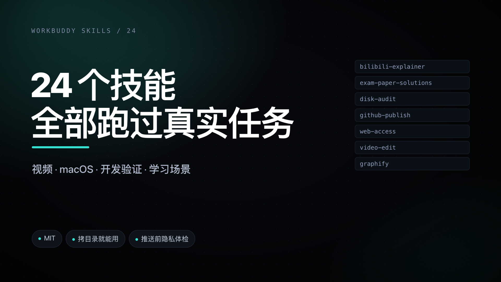
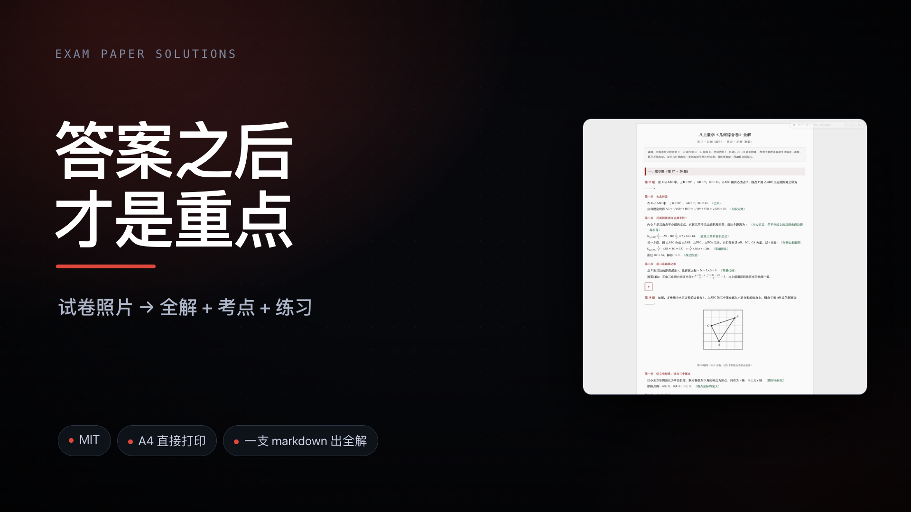

# String255 Skills

一组为 dsh（deepseek harness），兼容链路引导至其他agent或harness架构 / Claude Skills 生态编写的本地技能（Skill）。每个技能是一个独立目录，含 `SKILL.md`（元数据 + 操作手册）和可选的 `scripts/`、`references/`、`assets/`。

24 个技能，全部在真实任务里跑过、修过、稳定下来了——不是 demo，是每天在用的工具。它们覆盖三件事：**把内容做出来**（视频、课件、演讲稿）、**把机器管好**（磁盘、日历、安装包、照片、用量统计）、**把交付验住**（发布前体检、界面稳定性、无头验证）。

## 宣传片 / Promo

[](docs/promo.mp4)

22 秒，无旁白只有配乐。点封面看片。

[](docs/promo-exam.mp4)

30 秒，讲的是 `exam-paper-solutions`：错题为什么错、每一步的依据在哪。

## 目录结构

```
skills/
├── video/           视频生产流水线
├── macos/           macOS 系统工具
├── dev/             开发与验证
└── education/       学习与教育场景
```

## 技能清单

### video — 视频生产

| 技能 | 说明 |
| --- | --- |
| `bilibili-explainer` | 科普讲解短片一条龙：核实事实 → 六段式旁白 → edge-tts 配音 → Remotion 代码画图 → FFmpeg 合成 → 封面 → 投稿 B 站；也能出**无旁白快剪宣传片**（HTML 时间轴 + 逐帧截屏 + 原创配乐） |
| `tts-explainer-video` | 中文配音驱动、代码绘制画面的底层流水线：逐句配音、按实测时长对帧、Remotion 渲染、合成质检 |
| `bilibili-studio` | B 站创作闭环：投稿 → 抓五维诊断指标复盘 → 沉淀成可验证的策略库 |
| `bilibili-video-study` | 「拉片」：用官方公开接口 + videoshot 雪碧图逐帧读画面，产出镜头表、技法清单、出片检查表 |
| `ai-video-style-lab` | 三位 B 站 AI 创作者的拉片成果库与仿写工坊，含视觉语法、叙事公式、提示词模板、代码渲染管线 |
| `zero-cost-video` | 零成本出片：本地 Piper 配音 + Remotion 渲染 + 免费素材 + FFmpeg，全程不产生 API 费用 |
| `video-edit` | 剪真实拍摄的素材（手机/相机/录屏）：体检 → 抽帧看图 → 镜头表 → 按 EDL 粗剪出片 |

### macos — 系统工具

| 技能 | 说明 |
| --- | --- |
| `disk-audit` | 磁盘占用分级诊断：可直接删 / 先备份 / 需你判断。只读扫描，绝不删文件，内含 APFS 克隆等坑 |
| `macos-app-security-triage` | 陌生 `.dmg/.pkg/.app` 的安全取证：只读挂载 + 静态分析，先取证再运行，绝不双击 |
| `imessage-photo-archive` | 从「信息」App 按日期/联系人导出照片，并按消息随图文字自动分组归档 |
| `macos-calendar-via-terminal` | 绕开沙箱限制操作「日历」App（需编译 Swift + EventKit helper），支持批量增删改查与赛历导入 |
| `pdf-to-a4-landscape` | 把 PDF 里的照片/扫描件重排到 A4 横版：等比放大、零裁切、零重编码 |
| `local-toolbox` | 本地四件 CLI 的统一入口：graphify（知识图谱）、skillspector（技能安全扫描）、deeptutor（出题解惑）、impeccable（界面 AI 味检测） |
| `workbuddy-credit-report` | 本机 WorkBuddy 积分消耗明细：逐日 / 逐会话 / 逐项目 / 逐模型拆账，附规则化评价，全程离线 |
| `workbuddy-checkin-daemon` | 每日签到守护进程：token 不落地，兼容新版加密登录态 |

### dev — 开发与验证

| 技能 | 说明 |
| --- | --- |
| `github-publish` | 发布到 GitHub 的完整流程，内置**不可跳过的隐私体检门禁**：CRIT/HIGH 未清零不得推送 |
| `single-file-html-verify` | 在无人点击的沙箱里验证单文件 HTML 工具：node vm + DOM stub 跑断言，Playwright 实跑点击与截图 |
| `canvas-render-stability` | 诊断 Canvas/WebGL「画面抽搐、抖动、跳变」：先把症状量成数字，再动手改 |
| `web-access` | 所有联网操作的统一入口：搜索、抓取、登录后操作、动态渲染页，走真实浏览器环境 |
| `graphify` | 把代码库/文档建成可查询的知识图谱：query / explain / path，大项目不用翻目录 |

### education — 学习场景

| 技能 | 说明 |
| --- | --- |
| `exam-paper-solutions` | 把试卷/练习册照片整理成一份「全解」HTML，含本地 GUI 裁切工具 |
| `classin-lesson-digest` | 把 ClassIn 课堂截图 OCR 后拆成「例题 / 习题 / 知识点 / 答题方法」，输出可打印 HTML，方法沉淀进累积 docx |
| `bilingual-speech-deck` | 把调研资料做成「中英对照演讲稿 + 纯英文极简 PPT」，逐页一一对应 |
| `aviation-ai-daily` | 每天生成一节「航空 × AI 软硬件」图文课件（单文件 HTML），双线交替、零基础起步 |

## 使用方式

把需要的技能目录拷到你的技能目录即可：

```bash
# WorkBuddy（用户级）
cp -R skills/video/bilibili-explainer ~/.workbuddy/skills/

# Claude Code / 兼容实现（项目级）
cp -R skills/dev/github-publish ./.claude/skills/
```

部分技能有配套脚本，直接跑需要对应运行时：

```bash
python3 --version    # 3.9+
node --version       # 18+（Remotion 相关技能需要）
```

## 依赖说明

技能本身是 Markdown 手册，**不安装依赖也能被模型读懂**；只有实际执行脚本时才需要：

- **Python 3.9+**：`pdf-to-a4-landscape`（PyMuPDF）、`exam-paper-solutions`（Pillow）、`imessage-photo-archive`（标准库）
- **Node 18+**：`tts-explainer-video`、`bilibili-explainer` 的 Remotion 渲染部分
- **FFmpeg**：视频合成
- **edge-tts**：中文配音（`pip install edge-tts`）
- **Playwright**：`bilibili-explainer` 的投稿脚本、`single-file-html-verify` 的实跑验证、`web-access` 的登录态接管
- **FFmpeg / Pillow**：`video-edit` 的抽帧与合成；`workbuddy-credit-report` 只用标准库，读本地 SQLite

脚本里写成 `python3` 的地方，如果你的环境有专用解释器，用 `PYTHON` 环境变量覆盖即可。视频工程根目录默认 `~/BilibiliVideos`，可用 `BILIBILI_VIDEOS_ROOT` 改。

## 关于隐私

这个仓库里**没有**任何真实凭据。做过的处理：

- 所有 `/Users/<name>/` 绝对路径已脱敏为 `~` 或 `$HOME`
- 实名与他人信息替换为占位符（`张三` / `Zhang San`），品牌署名参数化为 `{{AUTHOR}}`
- B 站 Cookie、浏览器登录态、运行时状态目录一律未纳入
- 示例图片经逐张目视检查，仅含题目内容，无姓名/班级/学号

本轮更新（2026-11-21）又清了一遍：样例演讲稿里的真实姓名与校名换成占位符，新增技能里的登录态/运行数据目录一律排除。

如果你 fork 后往里加东西，`skills/dev/github-publish` 里的 `scripts/scan_secrets.py` 可以复用——跑一遍再推。

## License

MIT，见 [LICENSE](LICENSE)。
